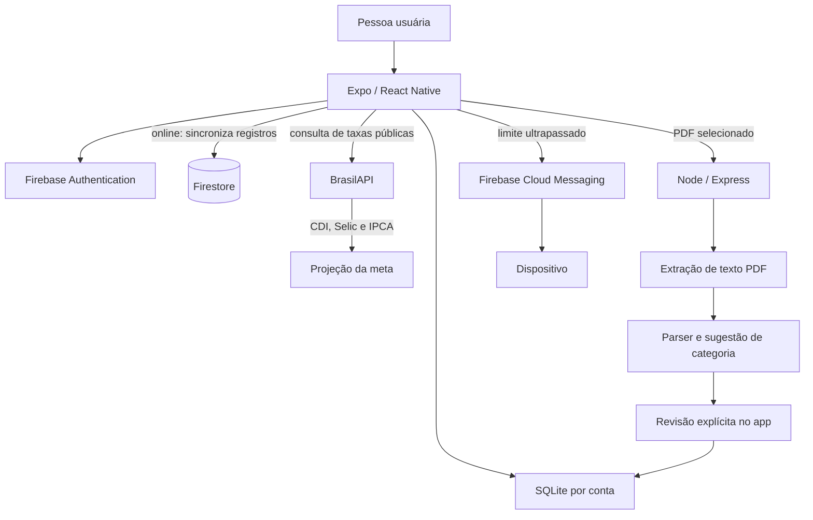

# Girls Wallet

Aplicativo mobile para organização financeira pessoal, com registro de despesas, acompanhamento de limites e metas, relatórios, funcionamento offline e importação revisável de faturas PDF.

> **Importante:** o app não acessa nem importa e-mails. A importação começa quando a pessoa seleciona uma fatura PDF no próprio dispositivo. PDF digitalizado, protegido por senha ou com estrutura ainda não reconhecida é recusado com uma mensagem; OCR não faz parte desta versão.

## Início rápido (sem configurar Firebase)

Para ver o app funcionando basta Node.js 20 ou superior, o aplicativo **Expo Go** no celular (ou um emulador) e dois terminais. Nenhuma conta ou credencial é necessária.

**1. App** (PowerShell, na raiz do repositório):

```powershell
Set-Location mobile
npm install
npx expo start
```

Leia o QR code com o Expo Go (celular e computador na mesma rede Wi-Fi; se a conexão falhar, use `npx expo start --tunnel`). Na tela de login, escolha **"Explorar com dados de demonstração"**: o app abre com dados de exemplo, que ficam só no aparelho.

> Se o Expo Go avisar que você está logado nele, mas não no Expo CLI, rode `npx expo login` no computador com a mesma conta ou saia da conta no Expo Go.

**2. Importação de fatura em PDF** (opcional, no modo demonstração):

```powershell
Set-Location server
Copy-Item .env.example .env
npm install
npm run dev
```

O `.env.example` já liga `ALLOW_ANONYMOUS_ANALYZE=true`, modo de desenvolvimento em que a API analisa o PDF sem login do Firebase. Depois informe ao app onde a API está:

```powershell
Copy-Item mobile\.env.example mobile\.env
```

e, em `mobile/.env`, defina `EXPO_PUBLIC_API_URL`: `http://10.0.2.2:4000` no emulador Android, ou `http://<IP-do-computador>:4000` no celular físico (descubra o IP com `ipconfig`; o firewall do Windows pode pedir permissão para a porta 4000). Deixe as variáveis do Firebase vazias e reinicie o app com `npx expo start -c`.

Há uma fatura fictícia pronta em [`samples/fatura-exemplo.pdf`](./samples/fatura-exemplo.pdf). Copie o arquivo para o aparelho (AirDrop, e-mail, Drive ou arrastando para o emulador) e, no app, toque em **Importar fatura** na tela Início (ou em *Perfil → Cartões e faturas*), escolha o cartão, o período 2026-10 e o PDF. A análise deve reconhecer 10 compras, num total de R$ 1.019,54, para você revisar antes de confirmar.

> `ALLOW_ANONYMOUS_ANALYZE` é só para desenvolvimento e demonstração. Em uso real, deixe-o desligado: a API passa a exigir o token do Firebase.

Login real, sincronização com o Firestore e push exigem um projeto Firebase próprio; veja "Instalação e execução" abaixo.

## Telas e fluxos

As telas seguem a referência [Girls Wallet no Figma](https://www.figma.com/design/MBJlnSJrTKJS8mkGFBhb9Y/Girls-Wallet?node-id=0-1&p=f&t=rFIZCC0Dp1scJ7gx-0): interface em português, valores em reais, fundo claro, tons de rosa/malva, cartões arredondados e navegação inferior por cinco áreas.

- **Acesso:** login por e-mail/senha ou Google, cadastro e recuperação de senha.
- **Início:** previsão do saldo disponível, resumo do orçamento, acesso rápido para registrar despesa/importar fatura e meta ativa.
- **Despesas:** busca, filtro de recorrentes/variáveis, listagem paginada, criação, edição e exclusão.
- **Orçamento:** cálculo de saldo disponível e visão dos limites por categoria.
- **Categorias:** criar/editar categorias e limites; alerta ao ultrapassar o orçamento.
- **Gastos fixos:** listagem e inclusão de despesas recorrentes.
- **Cartões e faturas:** cadastrar, editar e excluir cartões, consultar faturas importadas e seus lançamentos.
- **Importar fatura:** escolher cartão, período e PDF; processar a fatura na API; revisar, corrigir, remover e confirmar compras; evitar duplicidades.
- **Metas:** criar, editar, excluir e acompanhar objetivo, valor poupado, aporte mensal e data desejada.
- **Relatórios:** total registrado, gráficos por categoria e evolução mensal.
- **Perfil e configurações:** renda, despesas fixas, reserva, notificações, sincronização e encerramento de sessão.

O modo **Explorar sem conta** usa um conjunto de dados demonstrativos isolado. Ele não é enviado ao Firebase. Uma conta real começa em um banco local separado, sem os dados de demonstração.

## Tecnologias

| Camada | Tecnologias |
| --- | --- |
| App | React Native, Expo, TypeScript, React Navigation |
| Offline | SQLite via `expo-sqlite`; listagem local paginada |
| Autenticação | Firebase Authentication (e-mail/senha e Google); persistência de autenticação com `expo-secure-store` |
| Sincronização | Firestore, sincronização por conta quando há rede |
| Arquivos | Expo Document Picker; envio de PDF selecionado para a API |
| API | Node.js, Express, TypeScript |
| Faturas | `pdf-parse`; extração de texto e parser extensível; sem OCR |
| Push | Firebase Cloud Messaging via Firebase Admin; alertas locais com Expo Notifications |

## Arquitetura



- Cada conta e o modo de demonstração usam arquivos SQLite separados.
- Dados criados offline permanecem no dispositivo e são reconciliados com `users/{uid}/records` quando a conexão retorna. Em conflito, prevalece o registro com `updatedAt` mais recente.
- O SQLite é a fonte de leitura e gravação da carteira no dispositivo; a sincronização com o Firestore é iniciada quando há uma identidade autenticada e conexão de rede. Exclusões são registradas como tombstones para serem sincronizadas.
- O módulo de taxas consulta a BrasilAPI diretamente, sem chave, e a projeção da meta usa CDI como estimativa de rendimento composto. A consulta depende de internet; se falhar, o app informa a indisponibilidade e mantém os demais dados da meta, sem exibir projeção de rendimento. Taxas e projeções são informativas, não garantias de retorno.
- As regras em [`firebase/firestore.rules`](./firebase/firestore.rules) restringem cada conta ao próprio caminho.
- O PDF é analisado em memória na API; o arquivo original não é persistido pelo servidor. Nenhuma compra extraída é gravada antes da confirmação no app.
- A extração genérica atende layouts digitais que apresentem compras em linhas com data, descrição e valor. Layouts de emissores variam; adapte/adicione regras de parser para formatos não reconhecidos. O app informa a falha e não salva uma análise vazia.
- Alertas locais funcionam no dispositivo. Push remoto exige configuração de Firebase Admin, token FCM e credenciais nativas da plataforma.

### Organização dos módulos

- `mobile/App.tsx`: compõe os provedores globais, observa o estado de autenticação e seleciona o escopo da carteira.
- `mobile/src/navigation.tsx`: declara os fluxos de autenticação, abas principais e telas de detalhe.
- `mobile/src/contexts/WalletContext.tsx`: expõe operações e estado da carteira às telas; também observa a rede e coordena sincronização e alertas de orçamento.
- `mobile/src/data/`: contém os tipos dos registros, acesso SQLite, regras de orçamento e cálculos puros de projeção.
- `mobile/src/services/`: concentra integrações externas — Firebase/Auth/Firestore, BrasilAPI e análise de faturas.
- `mobile/src/screens/`: implementa as telas e os fluxos de interface.
- `server/src/`: fornece a API Express para análise de PDF e envio de notificações push.

## Segurança e privacidade

- **Autenticação e nuvem:** o Firebase Authentication valida as contas. As regras do Firestore permitem leitura e escrita somente quando o UID autenticado corresponde ao UID do caminho do documento. Revise e publique as regras de [`firebase/firestore.rules`](./firebase/firestore.rules) junto com qualquer alteração na estrutura de dados.
- **Credenciais:** a persistência de autenticação e o token de ID são guardados com `expo-secure-store`. As variáveis `EXPO_PUBLIC_*` são incluídas no app e não são segredos; a chave privada de Firebase Admin deve existir somente no ambiente seguro do servidor e nunca no app ou no repositório.
- **Dados no aparelho:** registros da carteira ficam em bancos SQLite separados por conta/modo de demonstração, no armazenamento privado do app. O projeto não habilita criptografia própria para esses bancos; proteja o dispositivo e considere isso antes de armazenar informações sensíveis. Sair da conta não é uma operação de apagamento dos dados locais.
- **Importação de fatura:** o PDF escolhido é enviado à URL configurada em `EXPO_PUBLIC_API_URL`, limitado a 10 MB e processado em memória pela API. O arquivo não é persistido pelo servidor; transações só são salvas depois da revisão e confirmação no app. Em produção, mantenha `ALLOW_ANONYMOUS_ANALYZE` desativado e exija autenticação.
- **Conexões:** use HTTPS na API publicada. Restrinja `CORS_ORIGIN` aos clientes esperados; CORS não substitui autenticação. Em desenvolvimento, `ALLOW_ANONYMOUS_ANALYZE=true` existe apenas para facilitar a demonstração local.
- **Serviço de taxas:** a consulta à BrasilAPI envia somente uma requisição pública de taxas, sem dados da carteira ou identificadores pessoais. Ela requer internet e não é uma fonte garantida de disponibilidade.
- **Notificações:** o push usa token Firebase autenticado; tokens de dispositivo são armazenados no caminho do usuário no Firestore. O alerta local é apresentado pelo próprio dispositivo conforme a permissão do sistema.

## Requisitos

- Node.js 20 ou superior e npm.
- Expo Go para prototipagem ou toolchain nativa Android/iOS para compilar a versão final.
- Projeto Firebase com Authentication (e-mail/senha e Google) e Firestore habilitados.
- Para PDF, API Express disponível na rede do aparelho.
- Para push remoto, Firebase Admin credentials, configuração FCM do Android e credenciais APNs do iOS.

## Instalação e execução

Na raiz do repositório, em PowerShell:

```powershell
Copy-Item mobile\.env.example mobile\.env
Copy-Item server\.env.example server\.env

Set-Location mobile
npm install
npx expo start
```

Em outro terminal:

```powershell
Set-Location server
npm install
npm run dev
```

Preencha `mobile/.env` com a configuração pública do app Firebase:

```dotenv
EXPO_PUBLIC_FIREBASE_API_KEY=
EXPO_PUBLIC_FIREBASE_AUTH_DOMAIN=
EXPO_PUBLIC_FIREBASE_PROJECT_ID=
EXPO_PUBLIC_FIREBASE_APP_ID=
EXPO_PUBLIC_GOOGLE_WEB_CLIENT_ID=
EXPO_PUBLIC_GOOGLE_IOS_CLIENT_ID=
EXPO_PUBLIC_GOOGLE_ANDROID_CLIENT_ID=
EXPO_PUBLIC_API_URL=http://localhost:4000
```

Para testar em um telefone físico, substitua `localhost` pelo endereço IP local do computador onde a API está rodando. As variáveis Firebase `EXPO_PUBLIC_*` são configurações de cliente, não substituem as regras de segurança. Nunca coloque a chave privada da conta de serviço Firebase no app.

Em `server/.env`, configure `FIREBASE_PROJECT_ID` e `GOOGLE_APPLICATION_CREDENTIALS` com o caminho local para a credencial de serviço. A credencial deve permanecer fora do repositório. O endpoint `/health` verifica a API; a análise de PDF é `POST /api/statements/analyze` (multipart/form-data, campo `file`, limite de 10 MB).

Para ativar login Google, cadastre os três OAuth Client IDs para os respectivos ambientes. Para distribuir builds nativos com push remoto, configure também o arquivo/serviço Firebase Android e APNs do iOS e registre cada dispositivo em `POST /api/push/register`.

## Testes e validação

```powershell
Set-Location mobile
npx tsc --noEmit

Set-Location ..\server
npm run build
npm test
```

## Auditoria de dependências

O `npm audit` do servidor terminou sem vulnerabilidades após atualizar `firebase-admin`. No app, ainda há 15 alertas HIGH nos pacotes de desenvolvimento Expo/React Native (`metro`, `node-forge` e `braces`, entre dependências relacionadas). O registro do npm não oferece correção compatível com o SDK atual; `npm audit fix` sugere downgrades incompatíveis (Expo 44 / React Native 0.72), que não foram aplicados. Reavalie quando o Expo publicar versões corrigidas compatíveis com o SDK 58.

## Capturas de tela

Para registrar imagens reais do app, execute o Expo, abra as jornadas no emulador/dispositivo e salve as capturas em `docs/screenshots/` antes de publicá-las. A referência visual das telas está no [arquivo Figma](https://www.figma.com/design/MBJlnSJrTKJS8mkGFBhb9Y/Girls-Wallet?node-id=0-1&p=f&t=rFIZCC0Dp1scJ7gx-0).
